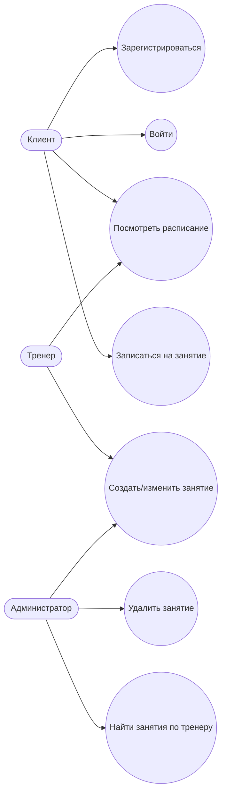
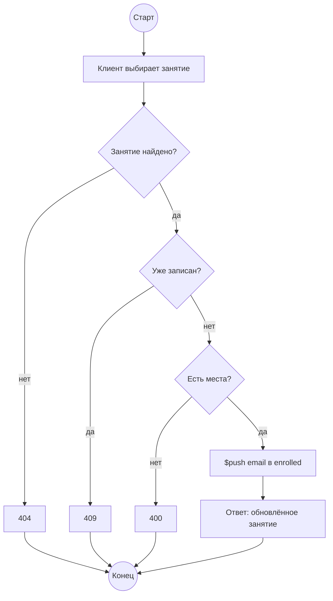

# Практическая работа. Подключение к нереляционной БД (MongoDB + Beanie)

## 1. Структура БД (тема: сайт управления фитнес-клубом)
| Коллекция | Документ | Поля |
|---|---|---|
| events | Event | title, image, description, tags[], location |
| users | User | email, password, events[Link→Event] |
| trainings | Training | title, trainer, hall, start_time, capacity, description, enrolled[email] |

## 2. Команды работы с записями (Beanie)
```python
await training.create()                                   # создать
await Training.get(id)                                    # получить по id
await Training.find(Training.trainer == "Иванова А.").to_list()   # выборка
await training.update({"$set": {"hall": "Зал 3"}})        # изменить поле
await training.update({"$push": {"enrolled": "a@b.ru"}})  # добавить в массив
await training.delete()                                   # удалить
```

## 3. Use case


## 4. Сценарии
**Запись на занятие.** Предусл.: клиент авторизован, занятие существует.
Основной: 1) клиент выбирает занятие; 2) система проверяет, что клиента ещё нет в списке; 3) проверяет наличие мест; 4) добавляет email в `enrolled`; 5) возвращает обновлённое занятие.
Альтернативы: занятие не найдено — 404; уже записан — 409; мест нет — 400.

**Создание занятия.** Основной: тренер/админ заполняет форму → система валидирует модель Training → документ сохраняется в коллекцию `trainings` → сообщение об успехе.

**Регистрация / вход.** Регистрация: проверка уникальности email (иначе 409) → сохранение. Вход: поиск по email (иначе 404) → сверка пароля (иначе 401).

## 5. BPMN: запись на занятие


## 6. Тесты (curl)
```
curl -X POST http://0.0.0.0:8080/training/new -H 'Content-Type: application/json' -d '{"title":"Йога","trainer":"Иванова А.","hall":"Зал 2","start_time":"2026-11-05T08:00:00","capacity":2}'
curl http://0.0.0.0:8080/training/
curl "http://0.0.0.0:8080/training/search/by-trainer?trainer=Иванова А."
curl -X POST http://0.0.0.0:8080/training/<ID>/enroll -H 'Content-Type: application/json' -d '{"email":"a@b.ru"}'
curl -X PUT http://0.0.0.0:8080/training/<ID> -H 'Content-Type: application/json' -d '{"hall":"Зал 3"}'
curl -X DELETE http://0.0.0.0:8080/training/<ID>
```
